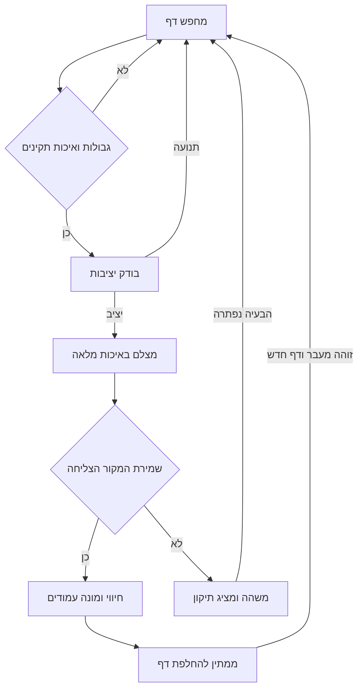

# DocScan אפיון ותוכנית פיתוח לאפליקציית סריקת מסמכים לאנדרואיד

טיוטת אפיון ותוכנית פיתוח ליישום אנדרואיד שסורק ערמות מסמכים במהירות, מצלם כל דף אוטומטית, מאפשר תיקון וחיתוך, ומייצא PDF אחד או תמונות לגלריה. תאריך בדיקת המקורות: 2 בנובמבר 2026.

**המלצה:** לבנות אפליקציה מקורית קטנה ב־Kotlin עם CameraX, ולהשתמש באופן ממוקד ברכיבי עיבוד מתאימים ובידע מהפרויקטים שנבדקו. לפני הרחבת הפיתוח יש לבצע ניסוי קצר במנוע הסריקה. ה־Fork המלא הקרוב ביותר לדרישות הוא OSS DocumentScanner, אך סביבת הבנייה שלו ותלות ה־PDF ב־iText מחייבות פתרון לפני אימוצו.

היעד לגרסה הראשונה הוא סריקה רציפה אמינה וממשק עברי פשוט. OCR, סנכרון ענן וכלי AI מתקדמים יוכלו להתווסף לאחר שהצילום, השמירה והייצוא עובדים היטב. זוהי תוכנית לפיתוח; התנהגות המצלמה והביצועים עדיין דורשים בדיקה במכשירים אמיתיים.

## המוצר והערך למשתמש

האפליקציה מיועדת לאנשים שסורקים מסמכים אישיים, חומר לימודי, קבלות וערמות דפים. משתמש צריך לפתוח אותה, להניח דף, להחליף אותו לאחר חיווי הצילום, ולסיים עם מסמך מסודר.

שלוש דרישות מובילות את ההחלטות: צילום רציף בלי לחיצה לכל דף; איכות ויכולת לתקן חיתוך גם לאחר השמירה; ותפעול מהיר שאינו דורש לימוד של מסכי הגדרות רבים. העבודה הבסיסית תתבצע מקומית, בלי צורך בחשבון.

ההנחה המוצרית היא שאפשר לבדל את המוצר באמצעות סריקה רציפה פשוטה, ממשק עברי איכותי ושליטה בתוצאה. לפני השקעה ביכולות מתקדמות נבדוק אותה עם 5–8 משתמשים, ובהם משתמשים שאינם טכניים. ביקוש מסחרי ונכונות לשלם טרם נבדקו.

## ממצאי בדיקת הקישורים

| מקור | ממצא שימושי | התאמה לפרויקט |
| --- | --- | --- |
| OSS DocumentScanner | יישום שלם ב־NativeScript ו־Svelte, עם רכיבי Kotlin ו־C++; צילום אוטומטי, מצב אצווה, חיתוך, מסמכים וייצוא | המקור הקרוב ביותר לחוויית הסריקה המבוקשת; מועמד ל־Fork מותנה |
| Azyrn Scanly | Kotlin ו־Compose; דגש משמעותי על OCR, תוצרים טקסטואליים ו־AI | מקור לעיצוב ולארגון תוצאות; בסיס רחב מדי לגרסת הסריקה הפשוטה |
| MakeACopy | יישום אנדרואיד מקומי עם ייבוא תמונות ו־PDF, עיבוד, חיתוך וייצוא | מקור טוב לעיבוד, ייבוא ובדיקות; דורש השלמה של הצילום האוטומטי המבוקש |
| AndroidDocumentScanner של mayuce | ספריית חיתוך ועיוות פרספקטיבה, ולא אפליקציה שלמה | רכיב או מקור ללימוד עורך החיתוך |
| Scanly בחנות עם מזהה com.appzee.scanlyai | דף החנות לא היה נגיש בבדיקה | אין בסיס לקשור אותה למאגר Azyrn או להניח שקוד שלה פתוח |
| MakeACopy בחנות | מזהה de.schliweb.makeacopy תואם לזה שהמאגר מציין כרשמי | תיאור החנות אינו תואם בכל פרט את הקוד העדכני; הקוד קובע את המצב הטכני |
| האתר הרשמי של CamScanner | מתאר סריקה מרובת עמודים, תיקון תמונה, ניהול PDF ויכולות AI | מקור להשוואת יכולות; האתר אינו תחליף לבדיקה באפליקציה המותקנת |

ההשוואה מבוססת על תיעוד וקובצי מקור רלוונטיים, לרבות מנגנוני צילום, הגדרות בנייה ורישיונות. איכות הסריקה, זמני העבודה ואמינות המצלמה לא נמדדו בהרצה.

מקורות: [OSS](https://github.com/ossappscollective/OSS-DocumentScanner), [Scanly](https://github.com/Azyrn/Scanly), [MakeACopy](https://github.com/egdels/makeacopy), [mayuce](https://github.com/mayuce/AndroidDocumentScanner), [MakeACopy בחנות](https://play.google.com/store/apps/details?id=de.schliweb.makeacopy), [CamScanner](https://www.camscanner.com/).

### OSS DocumentScanner

בתיעוד ובקוד קיימים Auto Capture ומצב Batch. מנגנון AutoScanHandler עוקב אחרי פינות הדף לאורך זמן ומפעיל צילום לאחר המתנה; מסך המצלמה מחבר אותו לפעולת צילום ולצבירת עמודים. נלמד ממנו את הפרדת זיהוי הדף, יציבות, צילום והמשך האצווה.

היישום משלב NativeScript, Svelte, OpenCV ו־Tesseract. הגדרות החבילות כוללות הפניות לפיתוח מקומי ולגרסאות מותאמות של רכיבים. לכן אין להסיק ש־Fork יהיה מוכן לבנייה מיידית. קיימים גם דיווחים פתוחים על Auto Capture ועל זיהוי קצוות ב־Android 17; אלה דיווחי משתמשים, ולא תקלות ששוחזרו בבדיקה זו.

נכס ה־APK ל־arm64 בגרסת Android 1.26.2 הוא בגודל 12,006,447 בתים, כ־11.45 MiB. זהו גודל הורדת APK של גרסה מסוימת; הוא אינו כולל בהכרח מודלי OCR נוספים או את כלל האחסון לאחר התקנה.

מקורות: [מדריך הצילום](https://github.com/ossappscollective/OSS-DocumentScanner/blob/c315bf3cdb43f79460ccf20d0156071a7d0adbdf/docs-site/docs/capture.md), [מנגנון הצילום](https://github.com/ossappscollective/OSS-DocumentScanner/blob/c315bf3cdb43f79460ccf20d0156071a7d0adbdf/plugin-nativeprocessor/platforms/android/java/com/akylas/documentscanner/AutoScanHandler.kt), [מסך המצלמה](https://github.com/ossappscollective/OSS-DocumentScanner/blob/c315bf3cdb43f79460ccf20d0156071a7d0adbdf/app/components/camera/Camera.svelte), [הוראות הבנייה](https://github.com/ossappscollective/OSS-DocumentScanner/blob/c315bf3cdb43f79460ccf20d0156071a7d0adbdf/Readme.md), [תקלה 740](https://github.com/ossappscollective/OSS-DocumentScanner/issues/740), [תקלה 738](https://github.com/ossappscollective/OSS-DocumentScanner/issues/738), [גרסאות](https://github.com/ossappscollective/OSS-DocumentScanner/releases).

### Scanly ו־MakeACopy

**Scanly:** הקוד מפעיל את סורק המסמכים של Google במצב מלא, מאפשר ייבוא מהגלריה ומגדיר PAGE_LIMIT של 20. המספר הזה הוא הגדרה של Scanly בקובץ שנבדק, ולא הוכחה למגבלה כללית של Google. מסך CameraX החלופי שנבדק כולל צילום ידני. ייצוא ה־PDF שמתואר ב־README מתמקד גם במסמך שנבנה מתוצאות OCR; אין להניח שכל מסלול ייצוא משמר את תמונת הדף המקורית. נלמד מהפרויקט על Compose ותוצאות OCR, בלי להכניס לגרסת הבסיס ספקי AI, ברקודים או מפתחות שירות מובנים.

מקורות: [מנהל הסורק](https://github.com/Azyrn/Scanly/blob/8da3cf509e67546917fc6634ae2c3643fb0a9744/app/src/main/java/com/skeler/scanely/core/scan/DocumentScannerManager.kt), [מצלמה חלופית](https://github.com/Azyrn/Scanly/blob/8da3cf509e67546917fc6634ae2c3643fb0a9744/app/src/main/java/com/skeler/scanely/ui/screens/CameraScreen.kt), [README](https://github.com/Azyrn/Scanly/blob/8da3cf509e67546917fc6634ae2c3643fb0a9744/README.md).

**MakeACopy:** קוד הבנייה הנוכחי דורש Android 10 ומעלה. הוא משתמש ב־CameraX וב־ONNX Runtime; לפי התיעוד העדכני, עיבוד התמונה עבר ל־Java ו־OCR ל־PaddleOCR. ה־README מציין כ־42 MB למהדורת Light וכ־108 MB למהדורה המלאה ל־arm64. ברכיב המצלמה שנבדק, קריאות הצילום מופעלות מלחצן וממקשי עוצמת הקול; לא אומת מנגנון צילום רציף אוטומטי שעונה לדרישה. לכן תמיכה במסמך מרובה עמודים אינה מספיקה כדי לבחור בו.

מקורות: [הגדרות הבנייה](https://github.com/egdels/makeacopy/blob/50831d85acb70d03a0edb388b40960c2a0316f66/app/build.gradle), [המצלמה](https://github.com/egdels/makeacopy/blob/50831d85acb70d03a0edb388b40960c2a0316f66/app/src/main/java/de/schliweb/makeacopy/ui/camera/CameraFragment.java), [README](https://github.com/egdels/makeacopy/blob/50831d85acb70d03a0edb388b40960c2a0316f66/README.md), [NOTICE](https://github.com/egdels/makeacopy/blob/50831d85acb70d03a0edb388b40960c2a0316f66/NOTICE).

### ספריית mayuce וההשוואה ל־CamScanner

ספריית mayuce מקבלת Bitmap, מציגה נקודות לחיתוך ומחזירה תמונה חתוכה עם תיקון פרספקטיבה. היא מציעה גם זכוכית מגדלת במכשירים מתאימים. היא אינה מספקת לבדה ספריית מסמכים, צילום רציף או ניהול אצווה. נבחן אם שימוש בה חוסך עבודה בלי לפגוע בזיכרון, באיכות וברישוי התלויות.

מקורות: [מדריך הספרייה](https://github.com/mayuce/AndroidDocumentScanner/blob/818500e7e7d6de961094b5f1659729c97c831b46/readme.adoc), [תלויות](https://github.com/mayuce/AndroidDocumentScanner/blob/818500e7e7d6de961094b5f1659729c97c831b46/documentscanner/build.gradle).

האתר של CamScanner מסייע להגדיר שלוש קבוצות יכולות: סריקה ותיקון בסיסי; ניהול וייצוא מסמכים; ועיבוד מתקדם כגון הסרת אצבעות, קימורים והשתקפויות. אין להסיק מהאתר שנוכל לשחזר את איכות המודלים שלו בעזרת פילטר פשוט.

בגרסה הראשונה נאמץ את הזרימה ואת סוגי הכלים המתאימים: קצוות אוטומטיים, תיקון ידני, סיבוב, צבע, גווני אפור, שחור־לבן וניהול עמודים. יישור ספר מעוקל והשלמת אזורים מוסתרים הם פרויקטים נפרדים. לא נשתמש בעיבוד שיוצר או משנה טקסט במסמך.

מקור: [יכולות הסריקה והעיבוד באתר הרשמי](https://www.camscanner.com/).

## רישיונות והחלטת הבסיס

רישיונות הקוד הראשיים שנבדקו הם MIT ב־OSS וב־mayuce, ו־Apache 2.0 ב־Scanly וב־MakeACopy. שימוש בקוד מחייב לשמור את הודעות הרישוי והייחוס הרלוונטיות; ב־Apache יש גם דרישות הנוגעות לקבצים ששונו ול־NOTICE. הרישיון הראשי אינו מחליף בדיקה של תלויות, מודלים ונכסים.

**ממצא מהותי:** ב־OSS, קובץ include.gradle כולל תלויות com.itextpdf.android וקוד PDFUtils משתמש בהן בפועל. iText מציגה את גרסאות 5 ואילך ברישוי כפול, AGPL או מסחרי. לכן אימוץ היישום בשלמותו אינו החלטת MIT בלבד. לפני הפצה יש לבחור מסלול רישוי מתאים, להחליף את רכיב ה־PDF או לבחור בסיס אחר.

מקורות: [MIT של OSS](https://github.com/ossappscollective/OSS-DocumentScanner/blob/c315bf3cdb43f79460ccf20d0156071a7d0adbdf/LICENSE), [תלויות iText](https://github.com/ossappscollective/OSS-DocumentScanner/blob/c315bf3cdb43f79460ccf20d0156071a7d0adbdf/plugin-nativeprocessor/platforms/android/include.gradle), [שימוש בקוד PDF](https://github.com/ossappscollective/OSS-DocumentScanner/blob/c315bf3cdb43f79460ccf20d0156071a7d0adbdf/plugin-nativeprocessor/platforms/android/java/com/akylas/documentscanner/utils/PDFUtils.kt), [רישוי iText](https://itextpdf.com/how-buy/AGPLv3-license), [Apache של MakeACopy](https://github.com/egdels/makeacopy/blob/50831d85acb70d03a0edb388b40960c2a0316f66/LICENSE), [NOTICE של Scanly](https://github.com/Azyrn/Scanly/blob/8da3cf509e67546917fc6634ae2c3643fb0a9744/NOTICE).

| מסלול | יתרון | עבודה וסיכון עיקריים | החלטה מוצעת |
| --- | --- | --- | --- |
| Fork מלא של OSS | מרבית פונקציות הסורק כבר קיימות | רישוי PDF, סביבת בנייה, פישוט UI ובדיקת צילום | חלופה אם נחליט לקבל את הארכיטקטורה ולפתור את הרישוי |
| Fork של MakeACopy | ייבוא ועיבוד מקומיים עשירים | משקל OCR והוספת צילום רציף | מקור לרכיבים ולידע |
| Fork של Scanly | UI מודרני ויכולות OCR | עודף יכולות ותלויות ביחס למוצר | לא בסיס מועדף |
| שילוב כמה Forks | מגוון יכולות קיים | כפילות מצלמה, אחסון וייצוא ומיזוג ארכיטקטורות | לא מומלץ |
| אפליקציה מקורית עם רכיבים נבחרים | שליטה בזרימה, באחסון ובמשקל | צריך לבנות ולבדוק את ליבת הסריקה | המסלול המומלץ |

ההמלצה על בנייה מקורית היא מסקנה הנדסית מהדרישות ומהתלויות. אין הוכחה עדיין שהיא תדרוש פחות ימי פיתוח מ־Fork; ניסוי הבנייה והצילום הראשון נועד לצמצם את אי־הוודאות הזאת.

## ניסוי טכני לפני פיתוח מלא

נבנה פרוסה קטנה שמצלמת, שומרת דף באיכות מלאה ומייצאת PDF. נבדוק שתי אפשרויות מוגבלות: סורק Google כקיצור דרך, ומצלמת CameraX עם זיהוי קצוות ותיקון פרספקטיבה. רק מנוע אחד ימשיך לגרסת הבסיס.

סורק Google מציע צילום אוטומטי, חיתוך, פילטרים ו־JPEG/PDF בעיבוד מקומי. לפי התיעוד, הוא מוסיף כ־300 KB להורדת האפליקציה, בעוד המשאבים הגדולים יורדים דרך Google Play services. הוא דורש לפחות API 21 ו־1.7 GB RAM; השימוש הראשון עשוי להמתין להורדה. זהו חיסכון בגודל החבילה של האפליקציה, ולא היעדר משאבים נוספים במכשיר.

ה־API המתועד מאפשר להגדיר מספר עמודים, ייבוא גלריה ומצב עריכה. הוא אינו מתעד מסירת מקור מלא ושליטה בכל שלב צילום כפי שנדרשים לשמירת כל דף מיד ולחיתוך חוזר. נוודא את ההתנהגות בפועל לפני הסתמכות עליו.

תנאי קבלה לניסוי: 30 דפים רצופים ללא נגיעה בין דפים; אין צילום חוזר של דף שנותר במקומו; דפים חדשים בעלי אותם גבולות מזוהים; תיקון חיתוך עובד; וניתן להמשיך מטיוטה לאחר הפסקה. אם מסלול Google אינו עומד בדרישות הליבה, ממשיכים ב־CameraX. אם גם המסלול המקורי אינו נותן איכות מספקת במהירות, חוזרים להערכת Fork של OSS עם פתרון מפורש לרישוי PDF.

מקורות: [סורק Google](https://developers.google.com/ml-kit/vision/doc-scanner), [תנאים וממשק Android](https://developers.google.com/ml-kit/vision/doc-scanner/android).

## היקף הגרסה הראשונה

| תחום | יכולת נדרשת בגרסה הראשונה |
| --- | --- |
| צילום | אוטומטי רציף, ידני, מיקוד בנגיעה, פנס וחיווי צילום |
| אצווה | הוספת עמודים למסמך, השהיה, המשך וסיום מפורש |
| זיהוי | מסגרת קצוות, בדיקת יציבות והתרעת איכות בסיסית |
| תיקון | ארבע פינות, הגדלה, תיקון פרספקטיבה, סיבוב וחזרה למקור שנשמר |
| עיבוד | מקור, צבע משופר, גווני אפור ושחור־לבן; בהירות וניגודיות |
| עמודים | תצוגה מקדימה, שינוי סדר, מחיקה עם ביטול, החלפת עמוד והוספת עמודים |
| ייבוא | מספר תמונות ו־PDF מהמכשיר, בחירת עמודי PDF והוספה למסמך קיים |
| PDF | כל העמודים או בחירה מהם לקובץ אחד; A4, Letter או התאמה למקור; איכות ייצוא |
| תמונות | שמירת JPEG או PNG לגלריה; עמוד יחיד או מספר עמודים |
| שיתוף | שיתוף דרך Android, פתיחת הקובץ המיוצא והדפסה דרך שירות המערכת |
| מסמכים | שמירה מקומית, שם, תאריך, מספר עמודים, חיפוש לפי שם ומיון |
| אמינות | שמירת טיוטה לכל עמוד שהושלם, שחזור והודעה ברורה על כשל או חוסר מקום |
| ממשק | עברית מלאה ו־RTL, אנגלית, נגישות ותצוגה במכשירים בגדלים שונים |

OCR לא נדרש כדי ליצור PDF שמכיל תמונות סרוקות. PDF שניתן לחפש בו טקסט הוא הרחבה נפרדת. לא תהיה מגבלת מוצר שרירותית של 20 עמודים; הקיבולת תיבדק ותיקבע לפי משאבי המכשיר. יעד הבדיקה הוא 100 עמודים למסמך, ולא הבטחה למספר בלתי מוגבל.

מחוץ לגרסה הראשונה: חשבונות, שרת, סנכרון אוטומטי, פרסומות, צ׳אט AI, המרה ל־Word, עריכת טקסט מקורי ב־PDF, חתימה דיגיטלית מאושרת ותיקון מתקדם של ספרים מעוקלים.

## חוויית השימוש והמסכים

| מסך | מה המשתמש רואה ועושה |
| --- | --- |
| מסמכים | לחצנים בולטים לסריקה ולייבוא; רשימת מסמכים וטיוטות; חיפוש לפי שם |
| סריקה | תצוגת מצלמה גדולה, מסגרת קצוות, מתג ברור אוטומטי או ידני, פנס, מונה עמודים וסיום |
| עמודים | תמונות ממוזערות, פתיחת עמוד, סדר מחדש, הוספה ומחיקה |
| עורך | חיתוך וסיבוב גלויים; פילטרים ותיקונים נוספים בלשונית נפרדת; לפני ואחרי וביטול |
| ייצוא | PDF או תמונות; שם ואיכות עם ברירות מחדל; שמירה ושיתוף כפעולות נפרדות |
| הגדרות | רק העדפות קבועות כגון איכות, חיווי ושפה; אפשרויות מתקדמות תחת הרחבה |

בפתיחה הראשונה יוצג הסבר קצר על הנחת דף והחלפתו. הרשאת מצלמה תתבקש כשפותחים סריקה. מצב צילום אוטומטי יהיה גלוי וניתן לשינוי בנגיעה, ולא מוסתר בלחיצה ארוכה.

מסלול הסריקה המרכזי: פתיחה, בחירה בסריקה, הנחת דף, חיווי שנשמר, החלפת דף וחזרה על הפעולה. בסיום עוברים למסך העמודים, מתקנים רק את הדפים שדורשים זאת, ומייצאים. לא יידרש אישור חיתוך אחרי כל דף במצב הרציף.

תוויות וחיצי ניווט יותאמו ל־RTL. סדר המסמך יישאר סדר הצילום גם אם פריסת התמונות ממוזערות מימין לשמאל. שמות קבצים ומספרי עמודים יישארו קריאים בשילוב עברית ואנגלית. לכל פעולה יהיה תיאור ל־TalkBack, אזור מגע מתאים וחיווי שאינו מבוסס רק על צבע.

## מנגנון הצילום הרציף

הצילום האוטומטי יתבסס על זיהוי דף תקין, יציבות לאורך זמן, איכות מספקת והבחנה בין הדף הקודם לדף הבא. ספי היציבות, התאורה וההמתנה יכוילו במכשירי הבדיקה.

כללי המימוש:

- הניתוח יעבוד על תמונות תצוגה קטנות. הקובץ הנשמר יצולם בנפרד באיכות מלאה; לא נשמור צילום מסך של התצוגה.

- דף שנותר במקומו לא יצולם שוב בגלל טיימר או תזוזה קלה.

- החלפת דף תזוהה גם כשהפינות נשארות באותו מקום, באמצעות שינוי תוכן ואירוע מעבר. השוואת פינות בלבד אינה מספיקה.

- בדפים כמעט זהים או ריקים נשתמש באירוע הוצאה והחזרה; יישאר לחצן ידני למקרה שהמערכת אינה מצליחה להבחין.

- במהלך תנועה, החלפת דף או הסתרה משמעותית תיעצר ספירת היציבות.

- החיווי יופיע רק אחרי שמירה מוצלחת. לא נוסיף למונה עמוד שלא נשמר.

- חזרה מרקע או משיחת טלפון תמשיך מהטיוטה ותדרוש מצב יציב חדש.

- תור העיבוד יהיה מוגבל. אם הוא עמוס, נשהה צילום נוסף ונציג חיווי במקום לצבור תמונות בזיכרון.

ב־CameraX נשתמש בניתוח שאינו חוסם את התצוגה ובשמירת הפריים האחרון לניתוח, בהתאם להמלצות Android. מקור: [Image analysis](https://developer.android.com/media/camera/camerax/analyze).

## חיתוך ותיקון איכות

נשמור צילום מקור בלתי משתנה ופקודות עריכה נפרדות: פינות, זווית, פילטר ופרמטרים. כך אפשר לתקן חיתוך לאחר שמירה בלי לדחוס שוב ושוב את אותה תמונה. העורך יציג תצוגה מקדימה מהירה ויפיק את התוצאה המלאה ברקע.

עורך החיתוך יכלול ידיות פינה, רשת יישור, הגדלת האזור הנגרר ומצב מסך מלא. המרת הקואורדינטות תטפל ב־EXIF, בסיבוב המכשיר ובהבדל בין המצלמה לתצוגה. נבדוק שהטקסט בקצות הדף אינו נחתך.

פילטר שחור־לבן לא יוחל אוטומטית על כל מסמך: הוא עלול לפגוע בכתב חלש, בחותמות או בסימון צבעוני. המשתמש יוכל להחיל פילטר על עמוד אחד או על כל המסמך ולבטל אותו. שיפור תאורה בסיסי לא יוגדר כהסרה מלאה של צללים או השתקפויות.

תיקון פרספקטיבה מיישר דף שטוח שצולם בזווית. יישור דף ספר מעוקל דורש עיבוד אחר ואינו מובטח בגרסה הראשונה. המקור יישמר גם אם בעתיד נוסיף שיפור מתקדם.

## ייבוא ושמירה למכשיר

תמונות ייבחרו דרך Photo Picker או בוחר הקבצים, ו־PDF דרך Storage Access Framework. נקבל גם שיתוף קובץ מאפליקציה אחרת. לאחר הייבוא נציג את סדר העמודים לעריכה; לא נניח שסדר הבחירה שספק הקבצים החזיר תמיד תואם לכוונת המשתמש.

קובצי המקור שיובאו לא ישתנו. ייבוא PDF למסלול הסריקה ייצור עותקי תמונה של העמודים שנבחרו, ברזולוציה מתאימה. עותק זה אינו שומר בהכרח שכבות טקסט, קישורים, טפסים או תוקף חתימה דיגיטלית של המקור. מיזוג PDF ששומר את המבנה המקורי יהיה יכולת נפרדת. PDF מוצפן או פגום שאינו נתמך יציג הסבר ברור.

שמירת תמונות לגלריה תבוצע דרך MediaStore, לתיקייה ייעודית בתוך Pictures, עם שמות עמודים מסודרים. זו דרישה נפרדת משמירה לתיקיית Downloads או מאפשרות שיתוף. קבצים מיוצאים יוכלו להישאר במכשיר גם לאחר הסרת האפליקציה; טיוטות ומקורות באחסון הפרטי אינם גיבוי חיצוני.

PDF יישמר למיקום שהמשתמש בחר. נשמור מידע על הצלחת הייצוא, נטפל בהתנגשות שמות, ונציג שגיאה אם אין הרשאה או מקום. ייצוא חלקי לא יוצג כקובץ שהושלם.

מקורות: [Photo Picker](https://developer.android.com/training/data-storage/shared/photo-picker), [MediaStore](https://developer.android.com/training/data-storage/shared/media), [PdfRenderer](https://developer.android.com/reference/android/graphics/pdf/PdfRenderer).

## ארכיטקטורה מוצעת

האפליקציה תהיה Native Android. נשתמש ב־Kotlin, ב־Jetpack Compose וב־CameraX; אחסון המטא־נתונים יהיה ב־Room והעדפות ב־DataStore. ברירת המחדל המוצעת לתמיכה היא Android 8 ומעלה, בכפוף למכשירי היעד ולתאימות הספריות.

בתחילת הדרך נשתמש במודול אפליקציה אחד עם הפרדה לחבילות אחריות: camera, processing, editor, documents, import ו־export. אין צורך במערכת שירותים או במספר רב של מודולים.

זיהוי קצוות ותיקון פרספקטיבה ייבחנו בעזרת OpenCV. אם הזיהוי הקלאסי לא יספיק, נבחן מודל קטן לאחר בדיקת רישוי ומשקל; לא נוסיף מנוע OCR גדול כדי לפתור זיהוי קצוות. OpenCV מגרסה 4.5 מופץ ברישיון Apache 2, אך יש לבדוק את החבילה ואת תלויותיה שנבחר בפועל.

ל־PDF שמכיל תמונות נבחן תחילה את PdfDocument של Android. נמדוד זיכרון, מהירות וגודל בקבצים ארוכים. אם לא יעמוד ביעדים, נבחר ספריית PDF מתאימה לאחר בדיקת רישוי. יכולות OCR, הצפנת PDF ושימור מסמכי PDF מקוריים לא יוסקו מעצם השימוש ב־PdfDocument.

מקורות: [רישוי OpenCV](https://opencv.org/license/), [PdfDocument](https://developer.android.com/reference/android/graphics/pdf/PdfDocument).

### מודל הנתונים ושחזור

| ישות | שדות מרכזיים |
| --- | --- |
| Document | מזהה, שם, מועדי יצירה ועדכון, מצב טיוטה או מסמך |
| Page | מזהה, מסמך, סדר, קובץ מקור, מידות, EXIF, מצב עיבוד וגרסת עריכה |
| PageEdit | פינות מנורמלות, סיבוב, פילטר, פרמטרים וגרסת צינור העיבוד |
| ExportJob | מסמך וגרסתו, פורמט, יעד, התקדמות, מצב ותיאור שגיאה |

תמונות לא יישמרו כ־Bitmap או כ־BLOB בתוך רשימת העמודים. כל עמוד יישמר לקובץ זמני, יאומת ויועבר לשם קבוע, ורק לאחר מכן תירשם ההפניה אליו. ניישם התאוששות מקבצים יתומים ומרישומים שאינם תקינים.

עיבוד וייצוא יתבצעו בעמודים ובתור מוגבל. שינוי סדר או מחיקה בזמן ייצוא לא ישנה את המסמך שכבר נמצא בייצוא; העבודה תקבל תמונת מצב של הסדר והעריכות. שמירת מקור, תצוגות מקדימות וייצוא צורכת אחסון נוסף, ולכן נציג ניהול מטמון ומקום פנוי. ניקוי אוטומטי לא ימחק מקור נחוץ לעריכה.

## פרטיות והרשאות

סריקה, חיתוך, אחסון וייצוא יתבצעו במכשיר. נבקש הרשאת מצלמה רק בעת הצורך ונשתמש בבוחרי קבצים כדי לצמצם גישה למדיה. לא נבקש מיקרופון, אנשי קשר או מיקום.

נתוני מסמכים, טקסט ותמונות לא ייכנסו ללוגים או לדוחות תקלות. שיתוף יעניק גישה זמנית רק לקובץ שנבחר. גיבוי המערכת יוגדר במפורש כך שהתנהגותו תתאים להבטחות הפרטיות; שמירה מקומית אינה בהכרח אומרת שהמערכת אינה מגבה את הנתונים.

ייבוא יבדוק סוג קובץ, ממדים, גודל ותוכן תקין לפני הקצאת זיכרון גדולה. קובץ חריג לא יפיל את כל האצווה. תמיכה עתידית בהורדת מודלים תכלול מקור ידוע, רישיון, בדיקת שלמות ואפשרות למחיקה.

אם נבחר בעתיד שירות AI, תידרש הפעלה מפורשת עם הסבר אילו נתונים נשלחים. אין להטמיע באפליקציה מפתח סודי של בעל השירות ולהתייחס להסתרתו כהגנה.

## יעדי ביצועים ותוכנית בדיקות

המספרים הבאים הם יעדי תכנון לגרסה הניסיונית. הם יכוילו לאחר בחירת מכשיר ייחוס ובדיקת איכות; אלה אינם תוצאות שכבר הושגו.

| מדד | יעד מוצע |
| --- | --- |
| פתיחה קרה עד מצלמה מוכנה | עד 2.5 שניות במכשיר הייחוס |
| דף יציב עד צילום ושמירה | עד 2 שניות ברוב המקרים בתאורה טובה |
| תצוגת מצלמה | לפחות 24 FPS במכשיר הייחוס, בלי קפיאות ארוכות |
| רצף ראשוני | 30 דפים ללא לחיצה בין דפים וללא אובדן עמוד שנשמר |
| מבחן עומס | מסמך בן 100 עמודים, ייצוא תקין וללא קריסת זיכרון |
| זיהוי אוטומטי | לפחות 95 מתוך 100 הצבות A4 בתנאי בדיקה מוגדרים |
| מקור שנותר במקומו | אין צילום כפול ב־30 ניסויים של המתנה לאחר צילום |
| גודל הורדה | יעד ראשוני עד 35 MiB ל־arm64 ללא חבילות OCR |
| קלות שימוש | לפחות 4 מתוך 5 משתמשים חדשים מסיימים מסמך של 5 עמודים ללא הדרכה צמודה |

נמדוד זמן חציוני ואחוזון 95, שימוש שיא בזיכרון, התחממות, גודל התקנה וגודל קבצים. בדיקות יבוצעו במכשיר ביניים, במכשיר חלש יותר ובמכשיר נוסף מיצרן אחר; אמולטור אינו תחליף למצלמות אמיתיות.

תסריטים מחייבים: דף כהה ובהיר, רקע דומה לדף, טקסט קטן בעברית, כתב חלש, חותמות, קבלה צרה, השתקפות, תנועה, פינות מוסתרות, דפים דומים וריקים, החלפה בלי שינוי פינות, סיבוב מכשיר, מעבר לרקע, עצירת תהליך, אחסון מלא ו־PDF פגום. יש לכלול גם בדיקת מצב טיסה, הרשאה שנדחתה ו־TalkBack.

בדיקות יחידה יתמקדו במכונת המצבים, המרת קואורדינטות, סדר עמודים ושחזור. בדיקות אינטגרציה יבדקו ייבוא, ייצוא ומספר עמודים. איכות תמונה תיבדק על קובצי מבחן שבבעלותנו או בעלי רישיון מתאים, ותכלול בדיקה חזותית שפעולות העיבוד אינן מוחקות תוכן.

## יכולות לאחר גרסת הבסיס

| שלב | הרחבות מוצעות |
| --- | --- |
| שיפור שימוש יומיומי | תיקיות, תגיות, מועדפים, מיזוג ופיצול מסמכים, דחיסה והגדרות ייצוא שמורות |
| OCR מקומי | הורדת שפות לפי בחירה, חיפוש והעתקת טקסט ו־PDF עם שכבת טקסט |
| מסמכים מיוחדים | תעודה דו־צדדית על דף, ספרים, קבלות ארוכות ופיצול עמוד כפול |
| ארכיון ושחזור | ייצוא ארכיון עם מקורות ועריכות, שחזור ובחירת תיקיית גיבוי |
| עיבוד מתקדם | תיקון קימורים, צללים ואצבעות לאחר ניסוי איכות ומשקל נפרד |
| שירותים אופציונליים | סנכרון שהמשתמש בוחר או AI, עם עלויות והרשאות ברורות |

**OCR בעברית:** אין להניח שממשק עברי או תמיכה בערבית מבטיחים זיהוי עברית. רשימת השפות של ML Kit Text Recognition v2 אינה מציעה מסלול עברית מתאים לדרישה הזאת. נבחן Tesseract עם מודל heb ו־eng או מנוע אחר על מסמכים אמיתיים. נבדוק גם סדר קריאה, ניקוד, עמודים בשני טורים וחיפוש והעתקה מתוך PDF. תמיכה בכתב יד תהיה נושא נפרד.

מקורות: [שפות ML Kit](https://developers.google.com/ml-kit/vision/text-recognition/v2/languages), [מודלי Tesseract](https://github.com/tesseract-ocr/tessdata_fast).

## עבודה כאן וסנכרון עם GitHub

הפיתוח ינוהל כאן, עם [המאגר 4pdara/DocScan](https://github.com/4pdara/DocScan) כמקור האמת לקוד ולתיעוד. לכל אבן דרך יהיה היקף ברור: בדיקת מצב Git והוראות המאגר, מימוש, בדיקות, עדכון תיעוד, סקירת diff, commit, דחיפה לענף העבודה ובדיקת CI. הדוח יציין את ה־commit, תוצאות הבדיקות ומצב Git הסופי.

מאחר שהמשתמש ביקש לעבוד כאן, Codex יכול להוביל את המימוש במסגרת זו. אם נעביר בהמשך משימה ל־Claude Code, נשמור על אותו מאגר ועל משימה אחת תחומה. אין צורך להפעיל כמה מממשים במקביל על אותם קבצים.

בכל אבן דרך נכין APK להתנסות. הפצת Release ציבורי ופרסום בחנות הם שלבים נפרדים. שם החבילה, מפתח החתימה וה־versionCode ייקבעו לפני ההפצה הראשונה; המפתח יישמר מחוץ למאגר ויגובה בידי הבעלים.

בבדיקת הסביבה הנוכחית לא נמצאו Android SDK, adb, אמולטור או javac זמינים. לכן מסלול הבנייה המתוכנן כולל GitHub Actions עם JDK ו־Android SDK מוגדרים; בדיקות מצלמה ייעשו במכשיר אמיתי. אין כעת תוצאת build או בדיקת מצלמה שאפשר לדווח עליה.

אם ייבחר בסיס פתוח למאגר עצמאי, נתעד מקור וגרסה ונשמור ייחוס ורישיונות. לא נבצע סנכרון אוטומטי שדורס את השינויים שלנו בגרסת upstream.

## אבני דרך ותוצרים

| אבן דרך | היקף | תנאי סיום |
| --- | --- | --- |
| 0 בדיקת מנוע | פרוסת צילום, השוואת מסלולים, איכות, משקל ורישוי | בחירת מנוע על סמך בנייה וניסוי במכשיר |
| 1 תשתית | פרויקט, CI, אחסון טיוטה ומסמך קטן | APK מותקן ששומר מסמך ומפיק PDF |
| 2 צילום רציף | יציבות, מניעת כפילויות, השהיה ושחזור | 30 דפים ללא לחיצות בין דפים |
| 3 עריכה ועמודים | חיתוך חוזר, סיבוב, פילטרים וסדר | עריכה מלאה בלי פגיעה במקור |
| 4 ייבוא וייצוא | תמונות, PDF, גלריה, שיתוף והדפסה | כל דרישות ההעברה פועלות בקבצים אמיתיים |
| 5 בטא | RTL, נגישות, ביצועים, עומס ותיקוני מכשירים | תרחישי הקבלה עוברים ותקלות מהותיות נסגרות |
| 6 חנות | חתימה, דף חנות, פרטיות וחבילת AAB | חבילה ותיעוד מוכנים למסלול הבדיקה המתאים |

הערכת מאמץ ראשונית למסלול המקורי: 2–4 ימי פיתוח לניסוי, ועוד כ־15–30 ימי פיתוח, בדיקות ותיקונים לגרסת בטא בהיקף הזה. זהו טווח תכנון, לא התחייבות למועד. הוא תלוי באיכות זיהוי הדפים, בגישה למכשירי בדיקה ובתוצאות הניסוי. אם נדרש אימון מודל או יישור ספרים מתקדם, יש לאמוד אותם בנפרד.

היעד הראשון הוא APK קטן עם הזרימה המלאה, כדי לקבל משוב מוקדם. עיצוב לוגו לא יעכב את ניסוי המצלמה.

## הפצה עלויות ותחזוקה

במסלול המקומי אין צורך בשרת לעיבוד כל סריקה, באחסון ענן של מסמכי המשתמשים או בעלות API לכל דף. עדיין יש עלויות אפשריות של פיתוח, מכשירי בדיקה, CI, חשבון חנות, שירותי צד שלישי ותמיכה. יש לבדוק מכסות ומחירים בחשבון הרלוונטי לפני התחייבות להוצאה.

לגרסת הבטא מומלצת חוויה ללא פרסומות, ללא הרשמה וללא סימן מים כפוי. לאחר שנמדוד שימוש אפשר לבחון רכישה חד־פעמית לכלים מתקדמים; אין כרגע הצדקה להחליט על מנוי רק משום שמדובר באפליקציה.

לקראת Google Play נכין AAB חתום, מדיניות פרטיות, Data safety שמשקף גם את הספריות, צילומי מסך ותיאור מדויק. ספריות Native ייבדקו לתאימות 16 KB. בחשבונות מפתח אישיים חדשים עשויה לחול חובת בדיקה סגורה: לפי ההנחיות שנבדקו, חשבונות אישיים שנוצרו אחרי 13 בנובמבר 2023 נדרשים לפחות ל־12 בודקים למשך 14 ימים רצופים לפני בקשת גישה לייצור. אין להניח שזמן הכנת APK הוא זמן אישור החנות.

מקורות: [דרישות בדיקה](https://support.google.com/googleplay/android-developer/answer/14151465), [Data safety](https://support.google.com/googleplay/android-developer/answer/10787469), [תאימות 16 KB](https://developer.android.com/guide/practices/page-sizes).

בתחזוקה נקבע עדכוני תלויות, בדיקת הרשאות, בדיקת Android חדש ושחזור טיוטות אחרי שדרוג. מסמכי המשתמשים לא ישמשו כנתוני בדיקה בלי בחירה מפורשת שלהם.

## שם ועיצוב

**שם המוצר שנבחר: DocScan.** מאגר הקוד והתיעוד הוא [4pdara/DocScan](https://github.com/4pdara/DocScan).

שם החנות ושם החבילה הסופי ייבדקו לפני פרסום. בחירת השם DocScan אינה קובעת כשלעצמה זמינות דומיין או זכויות בשם.

בהמשך נכין כמה דוגמאות לוגו עבור DocScan ונבחר אחת. הלוגו אינו חלק משלב המחקר והאפיון הנוכחי.

## בדיקה של CamScanner בטלפון

האפליקציה המותקנת בטלפון יכולה לעזור לדייק את האפיון. התיעוד המועיל ביותר הוא הקלטת מסך קצרה של ארבע פעולות: סריקה רציפה של 5 דפים; תיקון חיתוך; שינוי סדר או הוספת עמוד; ושמירה ל־PDF ולגלריה. אפשר להשתמש בדפי דוגמה נטולי מידע אישי.

נשווה כמה נגיעות נדרשות, מתי נשמע חיווי, האם נפתח עורך אחרי כל דף, איך מתנהגות פינות החיתוך ומה קורה כשחוזרים לערוך מסמך שמור. איכות הסריקה תיבדק גם בקובץ התוצאה, משום שהקלטת מסך לבדה אינה מוכיחה איכות פלט.

אין כרגע חיבור לשליטה ישירה בטלפון. APK אינו נדרש לאפיון הראשוני: ניתוחו יכול לסייע בהבנת הרשאות ורכיבים, אך אינו מבטיח גישה לאלגוריתמי שיפור, ואינו מעניק רשות להעתיק קוד, מודלים או נכסים. נממש התנהגות רצויה בקוד מתאים משלנו או ברכיבים בעלי רישיון מתאים.

## מצב העבודה והצעד הבא

בוצעו קריאת תיעוד וקוד ממוקד בארבעת המאגרים, בדיקת רישיונות ותלויות רלוונטיות, בדיקת קישורי החנות ותיעוד Google ו־Android, והשוואת יכולות באתר CamScanner. נכתב אפיון לגרסת בסיס, זרימות שימוש, מבנה נתונים, מנגנון צילום, בדיקות ותוכנית GitHub.

בתחילת הבדיקה המאגר הפרטי 4pdara/DocScan היה ריק, עם ענף ברירת מחדל main וללא commit או קוד קיים. בשלב הנוכחי מכינים בו תיעוד תכנון בלבד. לא בוצעו Fork, בניית APK, בדיקות מצלמה או פרסום אפליקציה. הגבלת הגישה לדף Scanly בחנות והיעדר מכשיר מחובר נשארו פערי הבדיקה. תוכן האפיון ומבנהו נבדקו; תצוגת הטבלאות והתרשים לא נבדקה בתצוגה חזותית.

הצעד הבא המומלץ הוא אבן דרך 0: ניסוי מצלמה וייצוא עם מדדי קבלה, תוך שילוב הדגמה מהטלפון אם תסופק. תוצאת הניסוי תקבע את מנוע הסריקה לפני הוספת יתר המסכים.

גרסאות המקור שנבדקו לצורך עקיבות:

| מאגר | ענף | commit |
| --- | --- | --- |
| OSS DocumentScanner | main | c315bf3cdb43f79460ccf20d0156071a7d0adbdf |
| Azyrn Scanly | main | 8da3cf509e67546917fc6634ae2c3643fb0a9744 |
| MakeACopy | main | 50831d85acb70d03a0edb388b40960c2a0316f66 |
| mayuce AndroidDocumentScanner | master | 818500e7e7d6de961094b5f1659729c97c831b46 |

לפני תחילת מימוש יש לרענן את מצב המאגרים ואת הוראותיהם. ערכי המקור לעיל מתעדים את הבדיקה הזאת ואינם הוראות קבועות לפרויקט.
